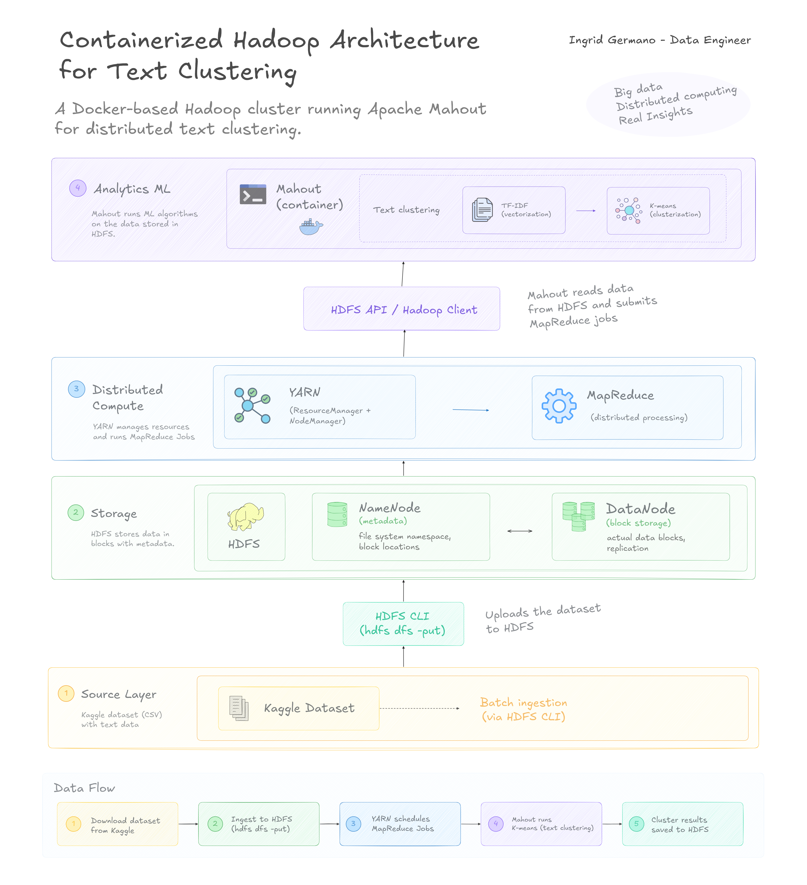
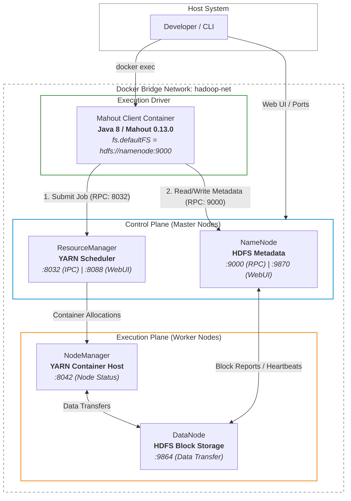

# Applied Big Data Analytics: Distributed Text Mining with Hadoop and Apache Mahout

This project containerizes an **Apache Hadoop 3.2.1** (HDFS / YARN) cluster and **Apache Mahout 0.13.0** execution client to process the **Reuters-50-50 dataset** using distributed sequence conversions, TF-IDF vectorization, and K-Means clustering.   Developed as a practical project for the **Data Mining** curriculum in **Computer Engineering**, the project evaluates how classical machine learning workflows interact with distributed storage and resource management frameworks.

While contemporary enterprise environments predominantly leverage in-memory processing engines such as **Apache Spark**, profilling MapReduce-based execution provides critical insight into core Big Data primitives. Consequently, the core goal serves both as an academic investigation into algorithmic text mining to empirically profile distributed storage mechanics, NameNode metadata friction, and disk-spill penalties during iterative MapReduce workloads. 

| Section | Description |
|---|---|
| [Hadoop Infrastructure](#01---containerized-hadoop-environment) | Dockerized Hadoop cluster with HDFS and YARN |
| [Mahout Pipeline](#02---text-clustering-with-apache-mahout) | TF-IDF and K-Means distributed clustering |
| [Dataset](#dataset) | Reuters-50-50 source and setup |
| [Reproducibility](#reproducibility) | How to run the complete pipeline |
| [Results](#results) | Cluster analysis and findings |

## Architecture

<picture>

<source
media="(prefers-color-scheme: dark)"
srcset="./assets/dark-big-data-mahout-arch.png">



</picture>

## Tech Stack

| Category | Technology | Usage / Function |
| :--- | :--- | :--- |
| **Containerization** | Docker / Docker Compose | Multi-container cluster orchestration & network isolation |
| **Core Distributed Platform** | Apache Hadoop 3.2.1 | Base framework providing distributed storage and resource scheduling |
| **Storage & Management** | HDFS & YARN | Block storage layer (`fs.defaultFS`) and compute resource manager |
| **Analytics Engine** | Apache Mahout 0.13.0 | Distributed machine learning CLI library running on MapReduce |
| **Runtime Environment** | Java 8 (OpenJDK) | Execution runtime required by Hadoop 3.x and Mahout binaries |
| **Data Mining Primitives** | SequenceFiles, TF-IDF, K-Means | Document aggregation, feature vectorization, and cluster centroids |

## Hadoop Cluster Infrastructure Topology



## End-to-End Mahout Data Mining Pipeline

The pipeline transforms raw unstructured documents into structured TF-IDF vector representations before running distributed K-Means clustering.


## Dataset

This project uses the Reuters-50-50 text classification dataset.

The dataset contains news articles organized into 50 categories, and it is used to demonstrate text processing and clustering using Apache Mahout.

**Dataset source**:
[UCI Machine Learning Repository - Reuters-50-50](https://archive.ics.uci.edu/dataset/217/reuter%2B50%2B50)

> *The dataset is downloaded externally and is not included in this repository.*

After extraction, the local structure should be:
```bash
data/
└── C50/
    ├── C50train/
    └── C50test/
```

The dataset is then uploaded into HDFS:

```bash
hdfs dfs -copyFromLocal /data/C50 /
```

## Environment Setup & Reproducibility

**Prerequisites:**
- Docker Engine $\ge 20.10$
- Docker Compose V2

#### Quick Start
This project is divided into two Docker environments:
- **01-containerized-hadoop-environment**: Hadoop infrastructure
- **02-mahout-text-clustering**: Apache Mahout machine learning pipeline

## Inter-Container Communication & Networking
The system operates across two decoupled Compose stacks linked via shared bridge network (`hadoop-net`).
- **Networking provisioning**: Created during infrastructure launch by `01-containerized-hadoop-environment`:
```bash
    networks:
    hadoop-net:
        name: hadoop-net
```
- **Client attachment**: Joined as an external network by `02-mahout-text-clustering`:
```bash
    networks:
      default: 
        name: hadoop-net
        external: true
```
- **DNS Resolution**: the client resolves HDFS and YARN daemons via container hostnames (`hdfs://namenode:9000` and `resourcemanager:8032`) using Docker's internal DNS engine, eliminating static IP configurations.

## Cluster Initialization
To spin up the core Hadoop infrastructure, execute:

```bash
cd 01-containerized-hadoop-environment
docker compose up -d
```

Subsequently, launch the dedicated Mahout client container:

```bash
cd ../02-mahout-text-clustering
docker compose up -d --build
```

Verify cluster status and active YARN NodeManagers:

```bash
docker exec -it namenode hdfs dfsadmin -report
docker exec -it resourcemanager yarn node -list
```

## Pipeline Execution

### 1. Dataset Ingestion

Access the client container and copy the **Reuters-50-50** text corpus into HDFS distributed storage:

```bash
docker exec -it mahout bash
hdfs dfs -mkdir -p /data
hdfs dfs -copyFromLocal /data/C50 /data/C50
```

### 2. Automated Pipeline Execution

The complete data mining workflow can be executed sequentially via the orchestration wrapper:

```bash
./scripts/run_clustering.sh
```
The script performs:
1. Document ingestion into Hadoop
2. Sequence file generation
3. TF-IDF vectorization
4. K-Means clustering
5. Cluster analysis

### 3. Stage-by-Stage CLI Workflow
For development and experimentation, individual Mahout stages can also be executed manually using native Mahout CLI commands:

### Execute Text Processing Pipeline
```bash
mahout seqdirectory \
-i /C50/C50train \
-o /seqreuters \
-xm sequential
```
### Generate TF-IDF vectors:
```bash
mahout seq2sparse \
-i /seqreuters \
-o /train-sparse
```

### Apply K-Means clustering:
```bash
mahout kmeans \
-i /train-sparse/tfidf-vectors/ \
-c /kmeans-train-clusters \
-o /train-clusters-final \
-dm org.apache.mahout.common.distance.EuclideanDistanceMeasure \
-x 10 \
-k 10 \
-ow
```

## Mining Results
```bash
Number of clusters: 10
Algorithm: K-Means
Feature representation: TF-IDF vectors
Distance measure: Euclidean Distance
```

Apache Mahout K-Means successfully grouped Reuters-50-50 documents into 10 clusters.
The generated clusters were analyzed using Mahout `clusterdump`, which extracts the highest-weight TF-IDF terms representing each cluster.

| Cluster ID | Representative Top Terms | Identified Topic Domain |
| --- | --- | --- |
| **VL-858** | `asset`, `stg`, `funds`, `management`, `investment` | Asset Management & Investment Funds
| **VL-2262** | `hong`, `tung`, `kong`, `legislature`, `china` | Hong Kong Political Transition & Governance
| **VL-379** | `gm`, `uaw`, `workers`, `plants`, `strike` | Automotive Industry & Labor Relations
| **VL-97** | `czech`, `klaus`, `coalition`, `senate`, `elections` | Czech Electoral Politics & Governance
| **VL-2138** | `index`, `points`, `sideways`, `sti`, `week` | Equity Markets & Stock Indices
| **CL-888** | `computer`, `software`, `microsoft`, `internet`, `corp` | Information Technology & Enterprise Software
| **VL-1372** | `china`, `chinese`, `beijing`, `hong`, `kong` | Chinese Foreign Affairs & Governance
| **VL-2213** | `million`, `percent`, `company`, `year`, `billion` | Corporate Financial Earnings & Performance
| **VL-1947** | `eaux`, `des`, `generale`, `canal`, `francs` | French Corporate Business & Infrastructure
| **VL-903** | `deficit`, `czech`, `crowns`, `crown`, `inflation` | Macroeconomics & Fiscal Indicators

The results demonstrates that unsupervised learning can identify meaningful patterns in text collections without predefined labels, plus effective thematic grouping across the news corpus:

## Empirical Systems Evaluation

An empirical examination of pipeline execution reveals fundamental structural trade-offs between distributed storage mechanics, compute execution models, and vector space metrics.

#### 1. The Small-Files Metadata Overhead
Ingesting thousands of raw text files directly into HDFS imposes a severe memory tax on the NameNode. Because HDFS manages file metadata entirely in JVM heap space—allocating approximately $150\text{ bytes}$ per file, directory, or block—storing a vast quantity of small files degrades cluster memory efficiency and leads to slow task scheduling. 

As detailed by Dean & Ghemawat (2004), MapReduce is designed for high-throughput batch processing over large, continuous splits rather than fine-grained random I/O. Furthermore, Owen et al. (2011) highlight that packing unstructured raw text into binary `SequenceFiles` (`Key: Document ID`, `Value: Text Content`) aggregates small records into optimal 128 MB HDFS block splits. Consequently, this document conversion step mitigates NameNode memory exhaustion while maximizing Map task processing efficiency.

#### 2. Disk-Bound Barriers in Iterative Workloads
MapReduce enforces strict physical synchronization barriers between execution phases, requiring all intermediate Map/Reduce output states to be materialized and written back to disk. For iterative algorithms such as K-Means ($x=10$), every iteration initiates an independent MapReduce job that reads centroids from HDFS, processes vectors, and writes updated coordinates back to distributed storage.

This disk-bound persistence model introduces significant network shuffle latency, disk serialization penalties, and job setup overhead on every iteration. As Zaharia et al. (2012) demonstrated in their foundational work on Resilient Distributed Datasets (RDDs), iterative ML tasks on MapReduce suffer an order-of-magnitude performance penalty compared to in-memory execution DAGs. This empirical bottleneck directly justifies the industry-wide migration from legacy MapReduce pipelines toward in-memory processing frameworks.

#### 3. Vector Sparsity and Distance Metric Saturation
Converting raw text documents via `seq2sparse` yields high-dimensional, sparse TF-IDF feature spaces. However, evaluating vector similarity using Euclidean distance (`EuclideanDistanceMeasure`) causes distance magnitudes between sparse vectors to concentrate around uniform values, deteriorating cluster separation.

As analyzed by Leskovec, Rajaraman, & Ullman (2020) in *Mining of Massive Datasets*, high-dimensional sparse representations suffer from the "curse of dimensionality," where geometric distance metrics lose discriminative power. Therefore, adopting Cosine Distance (`CosineDistanceMeasure`) or Spherical K-Means evaluates the angular displacement between document vectors rather than absolute spatial magnitude. 

## Architectural Comparision
| Dimension | Apache Mahout on MapReduce | Modern In-Memory Processing (Apache Spark) |
| :--- | :--- | :--- |
| **Execution Model** | Linear Map/Reduce pipeline with physical disk barriers | Dynamic Acyclic Graph (DAG) with in-memory execution |
| **Intermediate State** | Written to HDFS disk after every job iteration | RDD / DataFrame caching directly in RAM |
| **Iterative Latency** | High disk I/O and serialization penalties ($O(N)$ writes) | Minimal latency ($O(1)$ initial read, in-memory updates) |
| **Storage Primitive** | Binary Key-Value SequenceFiles | Schema-aware Columnar Formats (Parquet, Delta Lake) |


# References

- [Apache Hadoop.](https://hadoop.apache.org/docs/)

- [Apache Mahout](https://mahout.apache.org/)

- [Owen, S., Anil, R., Dunning, T., & Friedman, E. (2011). Mahout in Action. Manning Publications.](https://research.google/pubs/mahout-in-action/)

- [Dean, J., & Ghemawat, S. (2004). MapReduce: Simplified Data Processing on Large Clusters. Google Research](https://research.google/pubs/mapreduce-simplified-data-processing-on-large-clusters/)

- [Zaharia, M., et al. (2012). Resilient Distributed Datasets: A Fault-Tolerant Abstraction for In-Memory Cluster Computing. Proceedings of USENIX NSDI.](https://www.usenix.org/system/files/conference/nsdi12/nsdi12-final138.pdf)

- [Liu, Z. (2006). Reuters-50-50 Dataset. UCI Machine Learning Repository.](https://doi.org/10.24432/C5DS42)

- [Leskovec, J., Rajaraman, A., & Ullman, J. (2020). Mining of Massive Datasets.](http://www.mmds.org/)
